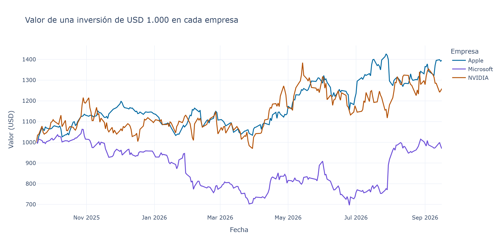

# Análisis de acciones tecnológicas: Apple, Microsoft y NVIDIA

Análisis en Python del precio de tres acciones tecnológicas durante 12 meses (17-09-2025 al 16-09-2026), con datos de Yahoo Finance.

**Pregunta:** si alguien hubiera invertido USD 1.000 en cada empresa hace un año, ¿cuál habría rendido más y cuál fue más inestable?



## Resultados principales

| Empresa | USD 1.000 al final | Rentabilidad |
|---|---|---|
| Apple (AAPL) | ≈ USD 1.396 | +39,6 % |
| NVIDIA (NVDA) | ≈ USD 1.259 | +25,9 % |
| Microsoft (MSFT) | ≈ USD 969 | −3,1 % |

Microsoft tiene el precio por acción más alto, pero fue la única que terminó abajo. El precio promedio no sirve para comparar rendimientos; hay que llevar todo a una misma base.

## Qué hace el notebook

1. Descarga precios de cierre con `yfinance` y revisa valores faltantes.
2. Calcula estadísticas descriptivas.
3. Grafica la evolución de precios con `plotly`.
4. Simula una inversión de USD 1.000 en cada empresa.
5. Calcula rentabilidad, volatilidad anual, mejor y peor día, y caída máxima.
6. Mide la correlación entre los retornos diarios.

## Herramientas

Python · pandas · yfinance · plotly

## Cómo ejecutarlo

```bash
pip install -r requirements.txt
```

Luego abre `analisis_acciones_tecnologicas.ipynb` en VS Code o Jupyter y ejecuta todas las celdas.

> Ejercicio de análisis de datos. No es una recomendación de inversión.

---
**Tamara Parra** · Analista de Datos · [Portafolio](https://tamaraparra.github.io/portafolio/) · [LinkedIn](https://www.linkedin.com/in/tamara-parra-nalda)
